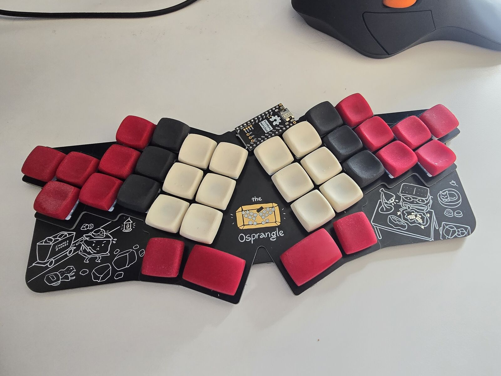

Hi, I'm Sam Mohr! (a.k.a. S'mores)
==================================

I'm a software developer and ergonomic keyboard designer.

My main boards are 34-key columnar boards with pinky clusters, in two families:

- [The Osprette](https://github.com/smores56/osprette) (unibodies)
- [The Clog](https://github.com/smores56/clog) (splits)

My older designs are in other repos, feel free to explore my old repos for more.

My dotfiles and NixOS config live in [nix-config](https://github.com/smores56/nix-config).
