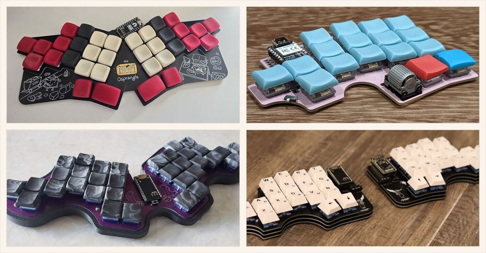

Hi, I'm Sam Mohr! (a.k.a. S'mores)
==================================

I'm a senior software engineer in Boston and an ergonomic keyboard designer.

I design 34-key columnar keyboards with pinky clusters, in two families:
[Osprette](https://github.com/smores56/osprette) (unibody) and
[Clog](https://github.com/smores56/clog) (split). Every board, old and new, is
in [the keyboard index](https://github.com/smores56/keyboards).

My site is [sammohr.dev](https://sammohr.dev) and my resume is [here](https://resume.sammohr.dev).
My dotfiles and NixOS config live in [nix-config](https://github.com/smores56/nix-config).
